# AuditLens

Audit anomaly detection for financial transaction populations, combining deterministic audit control rules with unsupervised machine learning.


---

## 1. Overview

Auditors are tasked with evaluating internal controls and verifying ledger integrity, but manual testing of every transaction in large datasets is operationally infeasible. Traditional audit sampling reviews small, randomly selected transaction subsets, frequently failing to identify split invoices structured just below sign-off limits, duplicate disbursements, unauthorized off-hours postings, and subtle statistical outliers across departments.

AuditLens evaluates the full population of financial transactions by pairing deterministic internal control rules with an unsupervised Isolation Forest anomaly detection model. Every transaction is scored on an interpretable 0 to 100 risk scale, accompanied by plain-English explanations of triggered rules and outlier factors. Auditors investigate flagged exceptions through an interactive review workbench, record review dispositions, obtain formal manager sign-off, and export standardized multi-sheet Excel workpapers with formula injection protections.

### Key Capabilities

- **Full-Population Scanning**: Ingests and evaluates complete accounting ledgers (50,000 transactions analyzed in ~2 seconds) without sampling bias.
- **Hybrid Anomaly Detection**: Combines 6 deterministic control rules (segregation of duties, duplicate disbursements, limit evasion) with Benford's Law analysis and an Isolation Forest statistical outlier model.
- **Explainable Risk Scoring**: Maps risk into High (70–100), Medium (50–69), and Low (30–49) tiers, attaching plain-English audit justifications for every triggered rule and statistical deviation.
- **Auditor Review Workflow**: Provides a dedicated workbench with server-side pagination, exception filtering, transaction inspection modals, audit disposition logging (requiring mandatory justifications for false positives), and role-gated manager sign-off.
- **Standardized Workpaper Deliverables**: Generates multi-sheet Excel workpapers (`Summary`, `Flagged Transactions`, `Rule Counts`, `Benford`, `Review Log`) with cell formatting and automated spreadsheet formula injection neutralization.

---

## 2. Screenshots

### Dashboard

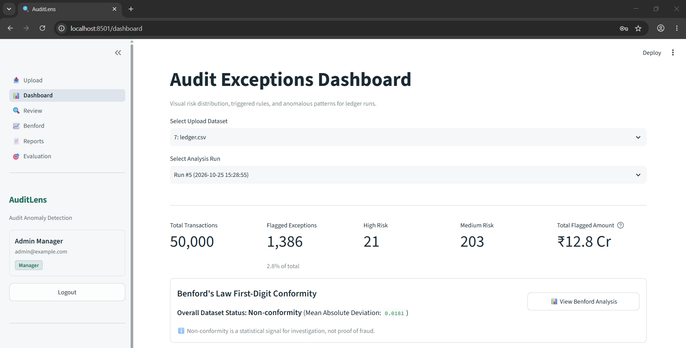
*Dashboard overview displaying total ingested transactions (50,000), flagged exception volume (1,386), risk level counts, total flagged amount (₹12.8 Cr), and Benford's Law status.*

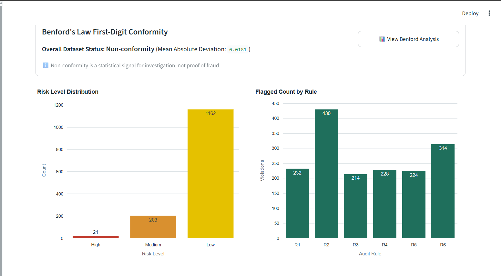
*Exception breakdown by risk tier (High: 21, Medium: 203, Low: 1,162) and distribution of flagged transactions across audit control rules (R1–R6).*

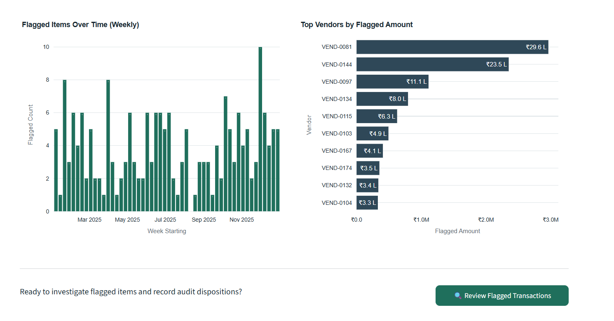
*Weekly volume of flagged exceptions over time and ranking of top vendors by total flagged exposure amount.*

### Review Workbench

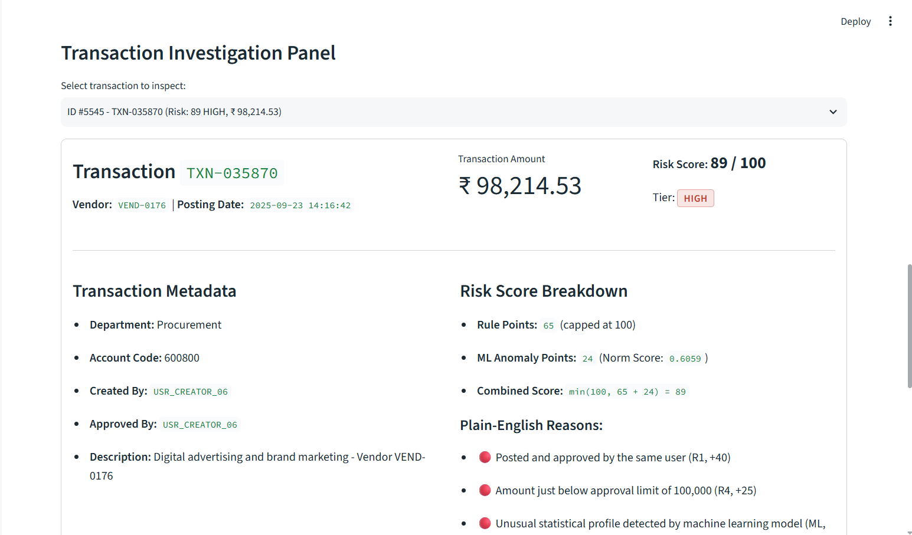
*Transaction investigation panel showing individual transaction metadata, composite score breakdown (Rule Points + ML Anomaly Points), and plain-English audit justifications.*

### Benford's Law Analysis

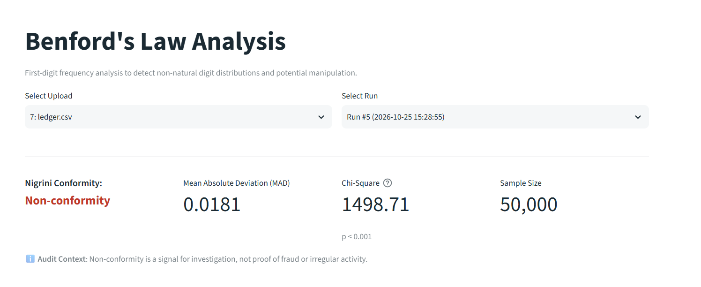
*Benford's Law analysis header with Nigrini conformity determination (Non-conformity), Mean Absolute Deviation (0.0181), chi-square statistic, and sample size.*

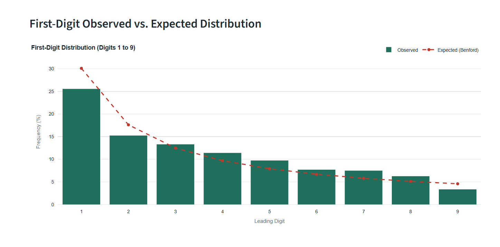
*First-digit frequency comparison showing observed leading digit frequencies against theoretical Benford's Law expectations.*

### Evaluation

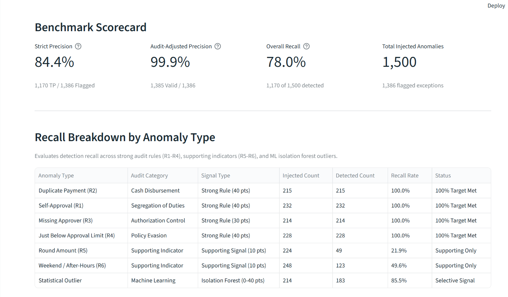
*Evaluation benchmark scorecard displaying strict precision (84.4%), audit-adjusted precision (99.9%), overall recall (78.0%), and detection rates across individual anomaly types.*

### Excel Workpaper Report

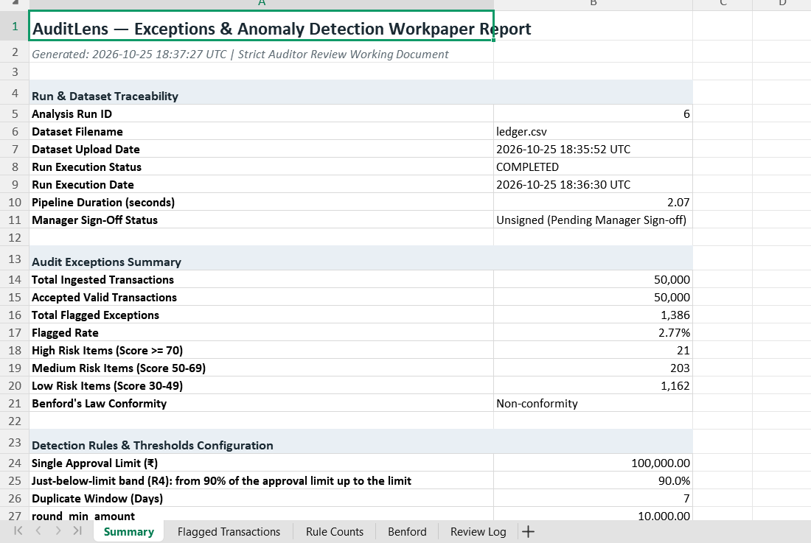
*Executive summary sheet of the exported Excel workpaper report showing dataset traceability, exception metrics, and active detection rule configurations.*

---

## 3. System Architecture

AuditLens is implemented as a modular three-tier application. The Streamlit frontend interacts exclusively with the FastAPI backend over HTTP using Bearer JWT authentication. The backend coordinates business logic across domain services and repositories backed by PostgreSQL 16. The pure analytics engine operates independently of web frameworks and database connections.

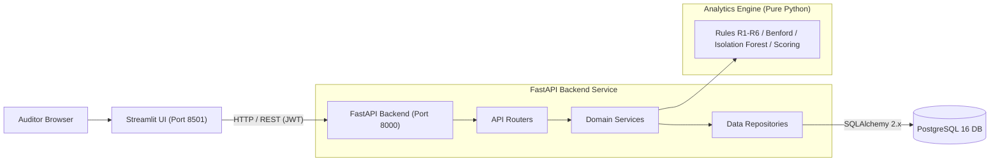

---

## 4. Analysis Pipeline

The end-to-end data processing workflow transitions from raw file ingestion to final signed-off audit workpaper:

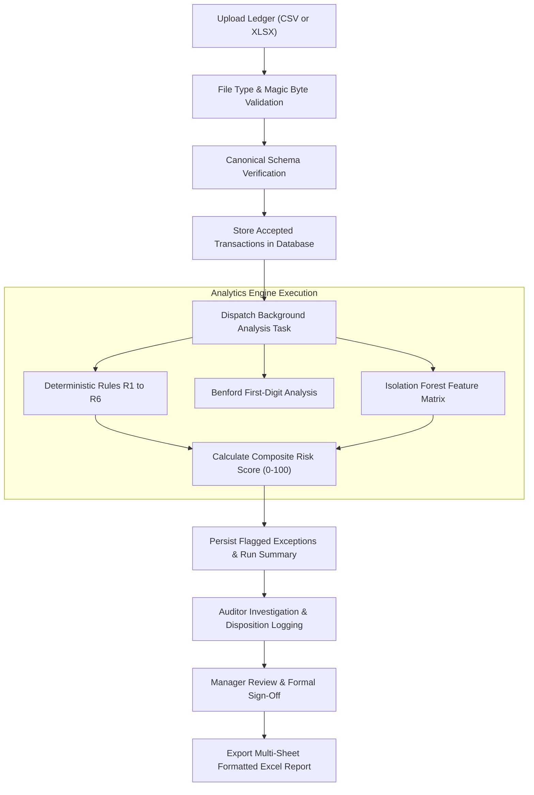

---

## 5. Risk Scoring

Transactions are evaluated against 6 deterministic audit control rules defined in [docs/AUDIT_RULES.md](docs/AUDIT_RULES.md):

| Rule Code | Rule Name | Condition | Points |
|---|---|---|---|
| **R1** | Self-approval | `created_by` equals `approved_by` (case-insensitive, trimmed, both non-empty) | 40 |
| **R2** | Duplicate payment | Identical `vendor_id` and `amount` within `duplicate_window_days` (default 7 days). All transactions in the group are flagged and share a `duplicate_group_id` | 30 |
| **R3** | Missing approver | `approved_by` is blank and `amount` >= `missing_approver_min_amount` (default ₹10,000) | 30 |
| **R4** | Just below approval limit | `approval_limit * just_below_band <= amount < approval_limit` (default ₹90,000 to ₹99,999.99 for ₹100,000 limit) | 25 |
| **R5** | Round amount | `amount >= round_min_amount` (default ₹10,000) and `amount` is an exact multiple of `round_multiple` (default ₹1,000) | 10 |
| **R6** | Weekend / after-hours | Posting date falls on a weekend day, or timestamp falls outside `business_hours` (default 08:00 to 20:00; hour check skipped if posting is date-only) | 10 |

### Scoring Formula

Rule points are summed and capped at 100. Machine learning anomaly points are derived from the Isolation Forest model output:

$$\text{risk\_score} = \min(100, \text{rule\_points} + \text{ml\_points})$$

$$\text{ml\_points} = \text{round}(\text{ml\_norm} \times 40)$$

Where $\text{ml\_norm} \in [0, 1]$ represents the min-max scaled negative anomaly score across the analysis run.

### Risk Tiers and Threshold

A transaction is flagged as an exception when its composite `risk_score >= 30` (`flag_threshold`):

| Risk Tier | Score Range | Description |
|---|---|---|
| **High** | 70 – 100 | Strong control violations (e.g., self-approval combined with limit evasion or severe statistical outlier). |
| **Medium** | 50 – 69 | Significant individual control violations or moderate compound indicators. |
| **Low** | 30 – 49 | Minor rule triggers combined with elevated statistical deviation scores. |
| **Not Flagged** | Below 30 | Transaction within standard operational variance; no audit exception raised. |

### Supporting Indicators (R5 and R6)

Rules R5 (Round amount) and R6 (Weekend / after-hours posting) are weighted at 10 points each. In routine business operations, round invoices for contract milestones or weekend postings occur legitimately; treating them as independent violations would cause auditor fatigue. Consequently, R5 and R6 serve as supporting signals that only trigger an audit flag when accompanied by another rule trigger or an elevated ML anomaly score sufficient to meet the 30-point threshold.

---

## 6. Database Schema

The database schema is defined in [docs/DATABASE.md](docs/DATABASE.md) and managed through versioned Alembic migrations:

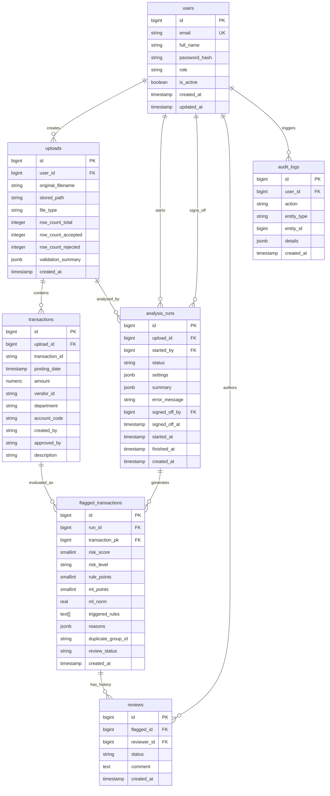

---

## 7. Tech Stack

| Layer | Technology | Purpose |
|---|---|---|
| **Frontend** | Streamlit 1.42+, Plotly 6.0+ | Interactive multi-page audit workbench, risk visualizations, and server-side paginated review interface |
| **Backend** | FastAPI 0.115+, Uvicorn, Pydantic v2 | Asynchronous REST API, schema validation, request authentication, and background task management |
| **Database** | PostgreSQL 16, SQLAlchemy 2.x, Alembic | Relational data persistence, cascade deletions, constraints, and versioned schema migrations |
| **Analytics & ML** | pandas 2.2+, NumPy, SciPy, scikit-learn 1.6+ | Pure Python vectorized rule evaluation, Benford's Law testing, and Isolation Forest anomaly modeling |
| **Authentication & Security** | PyJWT 2.10+, bcrypt 4.3+, SlowAPI | Stateless JWT access tokens, direct salted password hashing, IP rate limiting, and formula injection escaping |
| **Reporting** | openpyxl 3.1+ | Automated generation of styled 5-sheet Excel workpapers with number formatting and formula neutralization |
| **Testing** | pytest 8.3+, pytest-cov, httpx | Unit tests for rules and generators; integration tests for API endpoints and database integrity |
| **Quality & Typing** | Ruff, Mypy | Linting, automated formatting, and strict type checking on core analytics modules |
| **Deployment** | Docker, Docker Compose | Multi-container orchestration (FastAPI, Streamlit, PostgreSQL) with automated migrations and seed initialization |

---

## 8. Results on Synthetic Data

The performance metrics below were benchmarked on a synthetic 50,000-row accounting ledger generated via `scripts/generate_synthetic_ledger.py` with 1,500 injected anomalies across 7 categories.

> [!NOTE]
> These figures represent controlled testing on synthetic data with known ground-truth labels, not real client engagements. Production client populations exhibit higher label ambiguity and domain-specific variance.

| Metric | Result | Benchmark Context |
|---|---|---|
| **Ingested Population** | 50,000 transactions | Canonical schema (`data/ledger.csv`) |
| **Injected Anomalies** | 1,500 transactions (3.0%) | 7 distinct anomaly injection patterns |
| **Flagged Exceptions** | 1,386 transactions (2.77%) | 21 High, 203 Medium, 1,162 Low risk |
| **Flagged Exposure Amount** | ₹12.8 Cr | Total monetary value of flagged exceptions |
| **Pipeline Execution Time** | 2.18 seconds | Pure analytics engine execution (< 60s target) |
| **R1 (Self-Approval) Recall** | 100.0% (232 / 232) | Strong control rule target met |
| **R2 (Duplicate Payment) Recall** | 100.0% (215 / 215) | Strong control rule target met |
| **R3 (Missing Approver) Recall** | 100.0% (214 / 214) | Strong control rule target met |
| **R4 (Just Below Limit) Recall** | 100.0% (228 / 228) | Strong control rule target met |
| **R5 (Round Amount) Recall** | 100.0% rule-fire / 21.9% flag | 49 flagged when combined with ML/rule points |
| **R6 (Weekend/After-Hours) Recall** | 100.0% rule-fire / 49.6% flag | 123 flagged when combined with ML/rule points |
| **ML Outlier Recall** | 85.5% (183 / 214) | Isolation Forest statistical outlier detection |
| **Overall Anomaly Recall** | 78.0% (1,170 / 1,500) | Full population anomaly detection coverage |
| **Strict Precision** | 84.42% (1,170 / 1,386) | Exactly matches injected anomaly transaction IDs |
| **Audit-Adjusted Precision** | 99.93% (1,385 / 1,386) | Treats both sides of duplicate pairs as valid audit findings |
| **Clean Ledger Baseline** | 330 flagged items (0.66%) | Evaluated on `ledger_clean.csv` (0 rule hits; 330 Low-risk ML flags) |

---

## 9. Getting Started

### Prerequisites

- **Docker Option**: Docker Engine and Docker Compose v2+.
- **Local Option**: Python 3.11+, PostgreSQL 16 server.

### Host Port Mapping Note

In this project setup, the PostgreSQL host port is mapped to `5433` (configured via `POSTGRES_PORT=5433` in `.env`) to prevent collisions with native PostgreSQL services running on default port `5432`. Inside the Docker network, internal service communication uses port `5432`.
- Streamlit UI: `http://localhost:8501`
- FastAPI Backend: `http://localhost:8000`
- PostgreSQL Host Port: `localhost:5433`

---

### Option A: Docker Quick Start (Recommended)

1. **Clone the repository**:
   ```bash
   git clone <repository-url>
   cd auditlens
   ```

2. **Configure environment variables**:
   ```bash
   # Windows (Command Prompt - cmd.exe)
   copy .env.example .env

   # Windows (PowerShell) / macOS / Linux
   cp .env.example .env
   ```

3. **Generate synthetic ledger data**:
   ```bash
   python scripts/generate_synthetic_ledger.py --rows 50000 --seed 42 --out-dir data/
   ```

4. **Launch application containers**:
   ```bash
   docker compose up --build -d
   ```
   *Migrations and initial administrator seeding execute automatically on startup.*

5. **Access the application**:
   - Streamlit Web UI: [http://localhost:8501](http://localhost:8501)
   - Interactive API Docs (Swagger): [http://localhost:8000/docs](http://localhost:8000/docs)
   - Health Endpoint: [http://localhost:8000/health](http://localhost:8000/health)

6. **Log in with seeded administrator credentials**:
   - **Email**: `admin@example.com`
   - **Password**: `change_this_admin_password`

   > [!WARNING]
   > Default credentials and secret keys in `.env.example` are placeholders. In production (`APP_ENV=production`), the application strictly refuses to start if `JWT_SECRET` is the default placeholder or shorter than 32 characters. Always update `SEED_ADMIN_PASSWORD` and `JWT_SECRET` prior to deployment.

7. **Shut down containers**:
   ```bash
   docker compose down
   ```

---

### Option B: Local Development Run (Non-Docker)

1. **Create and activate a virtual environment**:
   ```bash
   # Windows (PowerShell)
   python -m venv .venv
   .venv\Scripts\Activate.ps1

   # Windows (Command Prompt - cmd.exe)
   python -m venv .venv
   .venv\Scripts\activate.bat

   # macOS / Linux
   python3 -m venv .venv
   source .venv/bin/activate
   ```

2. **Install package in editable mode**:
   ```bash
   pip install -e .
   ```

3. **Configure environment**:
   ```bash
   # Windows (cmd.exe)
   copy .env.example .env

   # PowerShell / macOS / Linux
   cp .env.example .env
   ```
   Ensure `DATABASE_URL` in `.env` points to your running PostgreSQL instance. If using Docker only for the database:
   ```bash
   docker compose up -d db
   ```

4. **Execute database migrations**:
   ```bash
   alembic upgrade head
   ```

5. **Seed administrator account**:
   ```bash
   python scripts/seed_admin.py
   ```

6. **Generate synthetic test data**:
   ```bash
   python scripts/generate_synthetic_ledger.py --rows 50000 --seed 42 --out-dir data/
   ```

7. **Start FastAPI backend** (Terminal 1):
   ```bash
   uvicorn app.main:app --port 8000 --reload
   ```

8. **Start Streamlit frontend** (Terminal 2):
   ```bash
   streamlit run frontend/app.py --server.port 8501
   ```

> [!NOTE]
> **Known Issue (Excel Report Filename in Container)**: When the frontend runs inside a Docker container, the browser may save the downloaded Excel report with a random hash name and missing `.xlsx` extension due to Streamlit container-bridge download streaming. Running the frontend locally (`streamlit run frontend/app.py --server.port 8501` connecting to the Docker API/DB) downloads the report correctly named as `auditlens_report_run_N.xlsx`.

---

## 10. API Overview

All API endpoints except `/health` and `/auth/login` require an `Authorization: Bearer <JWT>` header. For detailed schemas, request bodies, and error formats, see [docs/API.md](docs/API.md).

| Method | Endpoint | Allowed Role | Purpose |
|---|---|---|---|
| `GET` | `/health` | Public | Liveness probe and database connectivity verification |
| `POST` | `/auth/login` | Public | Authenticate credentials; returns JWT token (rate limited: 10/min) |
| `GET` | `/auth/me` | Authenticated | Fetch authenticated user profile and assigned role |
| `POST` | `/users` | Manager | Create an auditor or manager user account |
| `POST` | `/uploads` | Auditor, Manager | Upload and validate `.csv` or `.xlsx` transaction file |
| `GET` | `/uploads` | Auditor, Manager | List uploaded datasets (auditors see own; managers see all) |
| `GET` | `/uploads/{id}` | Auditor, Manager | Retrieve upload metadata and rejected-row summary |
| `DELETE` | `/uploads/{id}` | Auditor, Manager | Delete upload and cascade-delete transactions, runs, and reviews |
| `GET` | `/uploads/template` | Public | Download canonical CSV template |
| `POST` | `/uploads/{id}/analyze` | Auditor, Manager | Trigger asynchronous analysis run with threshold overrides |
| `GET` | `/runs/{id}` | Auditor, Manager | Poll analysis run status and summary statistics |
| `GET` | `/uploads/{id}/runs` | Auditor, Manager | List historical analysis runs for a dataset |
| `GET` | `/runs/{id}/benford` | Auditor, Manager | Retrieve Benford first-digit distributions, MAD, and flagged vendors |
| `POST` | `/runs/{id}/sign-off` | Manager | Record formal managerial sign-off (requires all items reviewed) |
| `GET` | `/runs/{id}/flagged` | Auditor, Manager | Query paginated, filterable, and sortable flagged exceptions |
| `GET` | `/flagged/{id}` | Auditor, Manager | Detailed exception inspection (metadata, score breakdown, audit trail) |
| `PATCH` | `/flagged/{id}/review` | Auditor, Manager | Record review status and mandatory false-positive justification |
| `GET` | `/runs/{id}/report?format=xlsx` | Auditor, Manager | Download formatted 5-sheet Excel workpaper report |
| `POST` | `/runs/{id}/evaluate` | Auditor, Manager | Benchmark run against ground-truth CSV (precision and recall) |

---

## 11. Project Structure

```
auditlens/
├── alembic/                         # Database migration scripts and environment
├── app/
│   ├── analytics/                   # PURE analytics engine (zero web/DB dependencies)
│   │   ├── benford.py               # Benford's Law analysis and Nigrini conformity evaluation
│   │   ├── evaluation.py            # Precision, recall, and benchmark scorecard computation
│   │   ├── features.py              # Feature extraction for Isolation Forest model
│   │   ├── ml.py                    # Isolation Forest anomaly detection and score normalization
│   │   ├── pipeline.py              # Orchestration of rules, Benford, ML, and scoring
│   │   ├── rules.py                 # Deterministic audit control rules (R1 to R6)
│   │   ├── scoring.py               # Composite risk scoring (0-100) and risk tier assignment
│   │   ├── settings.py              # Analysis settings schema and default audit thresholds
│   │   └── validation.py            # Schema validation and raw transaction cleaning
│   ├── core/                        # Configuration, JWT security, rate limiting, exceptions
│   ├── db/                          # Database connection, declarative base, SQLAlchemy models
│   ├── repositories/                # Database access objects and CRUD queries
│   ├── routers/                     # FastAPI route handlers (/auth, /uploads, /runs, /flagged)
│   ├── schemas/                     # Pydantic request and response schemas
│   ├── services/                    # Business logic orchestration and background processing
│   └── main.py                      # FastAPI application factory and middleware configuration
├── docs/                            # Comprehensive technical architecture, rules, and UX documentation
│   └── screenshots/                 # Application screenshots referenced in documentation
├── frontend/
│   ├── components/                  # Reusable UI components, Plotly chart builders, formatters
│   ├── pages/                       # Streamlit multi-page views (Upload, Dashboard, Review, etc.)
│   ├── api_client.py                # HTTP API client encapsulating all backend communication
│   └── app.py                       # Streamlit entry point and routing coordinator
├── scripts/
│   ├── generate_synthetic_ledger.py # Vectorized synthetic ledger generator with anomaly injection
│   └── seed_admin.py                # Idempotent script to seed initial administrator account
├── tests/
│   ├── fixtures/                    # Shared test datasets and DataFrame generators
│   ├── integration/                 # API endpoint and database integration test suites
│   └── unit/                        # Unit tests for analytics, rules, generator, and frontend
├── docker-compose.yml               # Multi-container service configuration (API, UI, DB)
├── Dockerfile.api                   # Container build recipe for FastAPI service
├── Dockerfile.frontend              # Container build recipe for Streamlit service
└── pyproject.toml                   # Project dependencies, packaging, and tool configurations
```

---

## 12. Testing and Quality

The repository enforces automated unit, integration, and UI testing alongside linting and static type checking.

### Test Suite Execution

Run the complete test suite:
```bash
pytest
```

Run test suite with code coverage reporting:
```bash
pytest --cov=app --cov-report=term-missing
```

**Current Test Results**:
- **Total Tests Passing**: 97 passed (unit, integration, and Streamlit AppTests)
- **App Code Coverage**: 91% total line coverage across `app/` (94% coverage on `app/analytics/`)

### Code Quality and Linting

Verify code formatting and linting rules with Ruff:
```bash
ruff check .
ruff format --check .
```
**Current Status**: 0 lint errors; 100% compliant formatting.

### Static Type Checking

Run static type checking across the pure analytics package with Mypy:
```bash
mypy app/analytics
```
**Current Status**: Success: no issues found in 10 source files.

---

## 13. Security

AuditLens is implemented following security practices outlined in [docs/SECURITY.md](docs/SECURITY.md):

- **Authentication**: Stateless JSON Web Tokens (JWT) using `PyJWT` paired with salted password hashing via `bcrypt` (work factor 12, no passlib abstraction).
- **Authorization & Ownership**: Strict role-based access control (`auditor` vs `manager`). Auditors are restricted to their own uploads and runs, while managers possess cross-dataset visibility and sign-off authority. Ownership violations return HTTP 404 to prevent entity enumeration.
- **Login Rate Limiting**: Authentication endpoints are rate-limited via `SlowAPI` to 10 requests per minute per client IP to mitigate credential brute-forcing.
- **File Upload Hardening**: Multi-stage upload validation enforcing maximum file size (25 MB), file extension verification, OpenXML ZIP magic byte checking (`PK\x03\x04`), UTF-8 decodability validation, binary null-byte rejection (`\x00`), and executable signature blocking (`MZ`, `\x7fELF`, Mach-O).
- **Formula Injection Neutralization**: All spreadsheet report exports (`.xlsx`) automatically sanitize formula trigger characters (`=`, `+`, `-`, `@`) by prepending a single quote (`'`) across text fields.
- **Vulnerability Auditing**: Evaluated via `pip-audit`, confirming 0 known vulnerabilities.
- **Pillow / Streamlit Compatibility Note**: Streamlit 1.42+ declares `pillow<13` in its metadata. To resolve 50 CVEs identified by `pip-audit`, `pillow>=13.0.0` and `certifi>=2026.10.23` are installed. Comprehensive automated testing across all Streamlit pages and Plotly visualizations confirms stable runtime compatibility.

---

## 14. Limitations and Future Work

### Current Limitations

- **Synthetic Data Baseline**: The system was developed and validated on synthetic transaction populations adhering to the canonical schema. Real enterprise enterprise resource planning (ERP) ledgers exhibit varied schemas, missing transaction descriptions, and disparate account hierarchies.
- **Benford's Law Non-Conformity on Synthetic Data**: Benford non-conformity is a statistical indicator for scoping, not proof of financial misstatement. Certain operational accounts (e.g., standard recurring contract fees, travel per-diems) deviate naturally from logarithmic distributions.
- **Per-Run ML Score Normalization**: Isolation Forest anomaly scores use min-max scaling to [0, 1] relative to each run's population. In a completely clean ledger, relative statistical variance produces ~0.66% Low-risk flags (330 of 50,000 items) driven by ML points alone.
- **In-Memory Rate Limiting**: The SlowAPI rate limiter maintains request counters in memory within the active API process. High-availability multi-instance deployments require a centralized cache (such as Redis) to enforce global limits.
- **In-Process Task Dispatch**: Background analysis runs are dispatched using FastAPI's in-process `BackgroundTasks`. For multi-million-row production workloads, task execution should be offloaded to a distributed worker cluster.
- **Schema Conformity**: Ingestion currently expects the canonical column naming convention; files with non-standard column names require manual alignment prior to upload.

### Roadmap

- **Interactive Column Mapping**: Browser UI allowing auditors to map arbitrary ERP ledger columns (SAP, Oracle NetSuite, Tally, QuickBooks) to the canonical schema during upload.
- **Public Benchmark Validation**: Benchmarking the analytics engine on public financial fraud datasets (such as PaySim).
- **Additional Control Rules**: Detection of vendor bank account changes prior to disbursement, sequential invoice gap identification, and dormant vendor reactivation tests.
- **Distributed Task Queue**: Migration from in-process background tasks to Celery / ARQ backed by Redis for multi-tenant scalability.
- **Enterprise Infrastructure**: Kubernetes Helm charts and cloud deployment recipes for containerized enterprise environments.

---

## 15. Documentation Index

The `docs/` directory contains comprehensive specifications and engineering records:

| Document | Description |
|---|---|
| [00_PROJECT_BRIEF.md](docs/00_PROJECT_BRIEF.md) | Original project brief, target problem statement, and phased development roadmap |
| [AGENTS.md](docs/AGENTS.md) | Agent operational guidelines, workflow rules, and development protocols |
| [API.md](docs/API.md) | REST API specification, endpoint contracts, query parameters, and error schemas |
| [ARCHITECTURE.md](docs/ARCHITECTURE.md) | System design, 3-tier component layering, data flow, and key technical decisions |
| [AUDIT_RULES.md](docs/AUDIT_RULES.md) | Control rules R1–R6, Benford's Law spec, ML features, scoring formulas, and generator spec |
| [CODE_STYLE.md](docs/CODE_STYLE.md) | Python and FastAPI code style standards, linting configuration, and conventions |
| [DATABASE.md](docs/DATABASE.md) | PostgreSQL schema, table definitions, relationships, foreign keys, indexes, and constraints |
| [DESIGN_SYSTEM.md](docs/DESIGN_SYSTEM.md) | Streamlit UI styling tokens, color palettes, typography, and component guidelines |
| [PHASE_PROMPTS.md](docs/PHASE_PROMPTS.md) | Phase-by-phase implementation instructions and acceptance verification criteria |
| [PRD.md](docs/PRD.md) | Product Requirements Document, user personas, and functional features F1 through F8 |
| [PROBLEMS_LOG.md](docs/PROBLEMS_LOG.md) | Engineering incident log (P-001 through P-020), root-cause analysis, and solutions |
| [PROGRESS.md](docs/PROGRESS.md) | Implementation milestones, benchmark results, test coverage, and changelog |
| [SECURITY.md](docs/SECURITY.md) | Security architecture, authentication, role authorization, and hardening checklist |
| [TESTING.md](docs/TESTING.md) | Testing strategy, unit and integration suites, test commands, and coverage targets |
| [UX_FLOWS.md](docs/UX_FLOWS.md) | User interaction flows, page wireframes, review states, and sign-off behavior |
