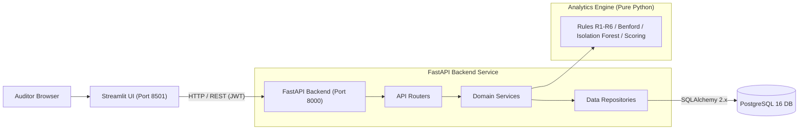
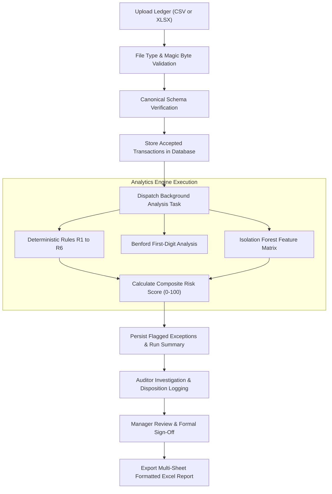
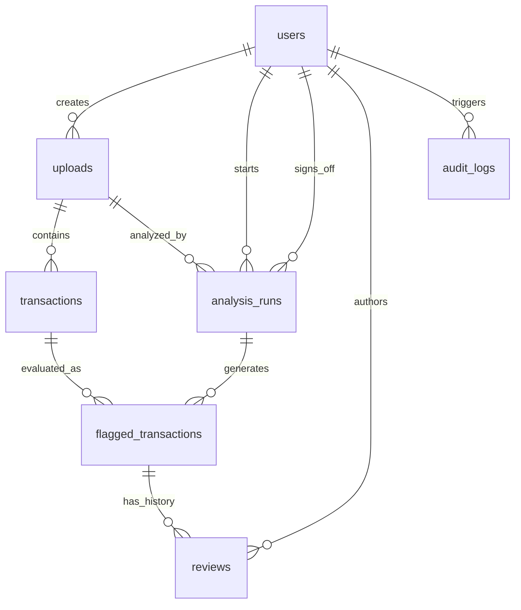

# AuditLens

Audit anomaly detection for financial transaction populations, combining deterministic audit control rules with unsupervised machine learning.


---

## 1. Overview

Auditors must evaluate internal controls and verify ledger integrity, but manual testing of every transaction in large populations is infeasible. Traditional audit sampling reviews small, random subsets, frequently missing invoices split just below sign-off thresholds, duplicate disbursements, unauthorized weekend entries, and subtle statistical outliers across departments.

AuditLens scans 100% of the transaction population by combining 6 deterministic internal control rules with an unsupervised Isolation Forest anomaly detection model. Every transaction receives an explainable 0 to 100 risk score with plain-English audit justifications. Auditors investigate flagged exceptions through an interactive review workbench, record review dispositions, secure formal manager sign-off, and export standardized multi-sheet Excel workpapers with formula injection protections.

- **Full Population Coverage**: Evaluates 50,000 transactions in ~2 seconds without sampling bias.
- **Hybrid Anomaly Detection**: Unifies deterministic control rules (R1–R6) with Benford's Law analysis and Isolation Forest outlier modeling.
- **Explainable Risk Scoring**: Assigns High (70–100), Medium (50–69), and Low (30–49) risk tiers with plain-English justifications.
- **Audit Workbench & Workpapers**: Review interface with mandatory justifications for false positives, manager sign-off, and formatted Excel exports.

---

## 2. Screenshots

| Dashboard Overview | Risk & Rule Distribution |
|:---:|:---:|
| [](docs/screenshots/dashboard-overview.png)<br><sub>Population metrics, risk tier counts, and flagged exposure.</sub> | [](docs/screenshots/dashboard-charts.png)<br><sub>Exceptions by risk tier and triggered audit rule.</sub> |
| **Review Detail** | **Benford's Law Analysis** |
| [](docs/screenshots/review-detail.png)<br><sub>Transaction inspection with score breakdown and plain-English reasons.</sub> | [](docs/screenshots/benford-chart.png)<br><sub>First-digit distribution vs. theoretical Benford curve.</sub> |
| **Benchmark Evaluation** | **Excel Workpaper Export** |
| [](docs/screenshots/evaluation.png)<br><sub>Precision and recall across injected anomaly types.</sub> | [](docs/screenshots/excel-summary.png)<br><sub>Multi-sheet report with dataset traceability and active thresholds.</sub> |

---

## 3. System Architecture

AuditLens uses a three-tier architecture with clean separation of concerns. The Streamlit frontend communicates with the FastAPI backend exclusively over HTTP using Bearer JWT authentication. The pure analytics engine has zero dependencies on web frameworks or databases.



---

## 4. Analysis Pipeline

Data moves from raw file ingestion to final signed-off audit workpaper through a deterministic pipeline:



---

## 5. Risk Scoring

Transactions are evaluated against 6 deterministic audit control rules from [docs/AUDIT_RULES.md](docs/AUDIT_RULES.md):

| Rule | Name | Condition | Points |
|---|---|---|---|
| **R1** | Self-approval | `created_by` equals `approved_by` (case-insensitive, trimmed, both non-empty) | 40 |
| **R2** | Duplicate payment | Same `vendor_id` and `amount` within `duplicate_window_days` (default 7 days) | 30 |
| **R3** | Missing approver | `approved_by` is blank and `amount` >= `missing_approver_min_amount` (default ₹10,000) | 30 |
| **R4** | Just below limit | `approval_limit * just_below_band <= amount < approval_limit` (default ₹90,000–₹99,999.99) | 25 |
| **R5** | Round amount | `amount >= round_min_amount` (₹10,000) and exact multiple of `round_multiple` (₹1,000) | 10 |
| **R6** | Weekend / after-hours | Posted on weekend or outside `business_hours` (08:00–20:00; hour skipped if date-only) | 10 |

### Scoring Formula and Tiers

Rule points are summed and capped at 100. Machine learning anomaly points are derived from the Isolation Forest model output:

$$\text{risk\_score} = \min(100, \text{rule\_points} + \text{ml\_points}) \quad \text{where} \quad \text{ml\_points} = \text{round}(\text{ml\_norm} \times 40)$$

Transactions with $\text{risk\_score} \ge 30$ are flagged as audit exceptions:
- **High Risk (70–100)**: Compound rule violations or severe statistical outliers.
- **Medium Risk (50–69)**: Significant individual control violations or moderate compound indicators.
- **Low Risk (30–49)**: Minor rule triggers combined with elevated statistical anomaly scores.

Rules R5 (Round amount) and R6 (Weekend / after-hours) are weighted at 10 points each as weak supporting signals. Legitimate business operations frequently contain round milestone payments or weekend entries; assigning 10 points prevents standalone flagging and avoids auditor fatigue unless combined with an elevated ML score or an additional rule.

<details>
<summary>Database schema (ER diagram)</summary>



The database stores 7 relational tables in PostgreSQL 16 (`users`, `uploads`, `transactions`, `analysis_runs`, `flagged_transactions`, `reviews`, and `audit_logs`). Deleting an upload cascades to its transactions, runs, and reviews. See [docs/DATABASE.md](docs/DATABASE.md) for full column attributes, indexes, and constraints.

</details>

---

## 6. Tech Stack

| Component | Technology | Purpose |
|---|---|---|
| **Frontend** | Streamlit 1.42+, Plotly 6.0+ | Multi-page audit workbench, risk visualizations, and review UI |
| **Backend** | FastAPI 0.115+, Pydantic v2, Uvicorn | Asynchronous REST API, schema validation, and background execution |
| **Database** | PostgreSQL 16, SQLAlchemy 2.x, Alembic | Relational data persistence, cascade deletes, and versioned migrations |
| **Analytics & ML** | pandas 2.2+, scikit-learn 1.6+, SciPy | Vectorized rule engine, Isolation Forest, and Benford's Law testing |
| **Auth & Security** | PyJWT 2.10+, bcrypt 4.3+, SlowAPI | Stateless JWT access tokens, direct salted hashing, and IP rate limiting |
| **Reporting** | openpyxl 3.1+ | Multi-sheet Excel workpapers with formula injection protection |

<details>
<summary>Tech stack details</summary>

- **Testing Tools**: pytest 8.3+, pytest-cov, httpx (TestClient) for API and database integration tests.
- **Code Quality**: Ruff for fast linting and formatting; Mypy for static typing on analytics modules.
- **Containerization**: Multi-stage Dockerfiles and Docker Compose orchestration.

</details>

---

## 7. Results on Synthetic Data

Benchmarked on a synthetic 50,000-row ledger (`scripts/generate_synthetic_ledger.py`) with 1,500 injected anomalies across 7 categories.

> [!NOTE]
> Tested on synthetic ledgers with known ground-truth labels, not client confidential data. Client populations exhibit greater label ambiguity and domain-specific variance.

| Metric | Result | Benchmark Context |
|---|---|---|
| **Ingested Population** | 50,000 transactions | Canonical schema (`data/ledger.csv`) |
| **Injected Anomalies** | 1,500 transactions (3.0%) | 7 distinct anomaly injection patterns |
| **Flagged Exceptions** | 1,386 transactions (2.77%) | 21 High, 203 Medium, 1,162 Low risk; ₹12.8 Cr flagged exposure |
| **Pipeline Execution Time** | 2.18 seconds | Pure analytics engine execution (< 60s benchmark) |
| **Strong Rules Recall (R1–R4)** | 100.0% | R1: 232/232, R2: 215/215, R3: 214/214, R4: 228/228 |
| **Supporting Signals (R5–R6)** | 100% rule-fire / 21.9% R5, 49.6% R6 flag | Flagged when combined with ML/rules to reach 30 pts |
| **ML Outlier Recall** | 85.5% (183 / 214) | Isolation Forest statistical outlier detection |
| **Overall Anomaly Recall** | 78.0% (1,170 / 1,500) | Full population anomaly detection coverage |
| **Precision (Strict / Adjusted)** | 84.42% strict / 99.93% audit-adjusted | Adjusted precision recognizes both duplicate pair entries |
| **Clean Ledger Baseline** | 330 flags (0.66%) | `ledger_clean.csv` (0 rule hits; 330 Low-risk ML flags) |

---

## 8. Quick Start

The fastest setup runs PostgreSQL and FastAPI in Docker, and Streamlit locally.

### Prerequisites

- [Docker Desktop](https://www.docker.com/) and Python 3.11+

### Running the Application

1. **Configure environment**:
   ```bash
   cp .env.example .env
   ```
   *(PostgreSQL host port maps to 5433 via `POSTGRES_PORT=5433` in `.env` to prevent local conflicts).*

2. **Start database and backend in Docker**:
   ```bash
   docker compose up -d db api
   ```
   *PostgreSQL (port 5433) and FastAPI (port 8000) initialize; migrations and admin user seed automatically.*

3. **Start Streamlit frontend locally**:
   ```bash
   pip install -e .
   streamlit run frontend/app.py --server.port 8501
   ```

4. **Access the application**:
   - Web UI: [http://localhost:8501](http://localhost:8501)
   - Interactive API Docs: [http://localhost:8000/docs](http://localhost:8000/docs)
   - Credentials: `admin@example.com` / `change_this_admin_password`

> [!WARNING]
> Seed credentials are placeholders. In production (`APP_ENV=production`), the backend refuses to start if `JWT_SECRET` is unchanged or shorter than 32 characters. Always update `SEED_ADMIN_PASSWORD` and `JWT_SECRET` prior to deployment.

> [!NOTE]
> **Known Issue (Excel Download in Docker)**: When Streamlit runs inside a Docker container, browsers may save the Excel report with a random hash name without `.xlsx`. Running Streamlit locally while API and DB run in Docker downloads reports correctly as `auditlens_report_run_N.xlsx`.

<details>
<summary>Alternative setup options (Full Docker or local non-Docker)</summary>

#### Option 1: Full Docker Deployment
Run all three services (DB, API, Frontend) in containers:
```bash
docker compose up --build -d
```
Stop all containers: `docker compose down`.

#### Option 2: Local Non-Docker Development
1. Ensure a PostgreSQL 16 server is running and configured in `.env`.
2. Activate virtual environment and install dependencies:
   ```bash
   python -m venv .venv
   source .venv/bin/activate  # Windows: .venv\Scripts\Activate.ps1 or .venv\Scripts\activate.bat
   pip install -e .
   ```
3. Run migrations and seed administrator:
   ```bash
   alembic upgrade head
   python scripts/seed_admin.py
   ```
4. Generate synthetic test data:
   ```bash
   python scripts/generate_synthetic_ledger.py --rows 50000 --seed 42 --out-dir data/
   ```
5. Start backend and frontend (separate terminals):
   ```bash
   uvicorn app.main:app --port 8000 --reload
   streamlit run frontend/app.py --server.port 8501
   ```

</details>

---

## 9. Limitations

1. **Synthetic data baseline**: Validated on canonical schema data; client ERP ledgers require custom column mapping and historical context.
2. **Benford's Law interpretation**: Non-conformity is an investigative scoping signal, not proof of fraud; recurring fixed contracts naturally deviate.
3. **Per-run ML normalization**: Isolation Forest min-max scaling produces ~0.66% Low-risk flags even on clean ledgers from normal variance.
4. **Weak supporting signals**: Rules R5 and R6 (10 pts each) require an accompanying rule or elevated ML score to reach the 30-point threshold.
5. **In-memory rate limiting**: SlowAPI tracks request counters in process memory; multi-worker deployments require a shared cache (Redis).
6. **In-process background tasks**: Execution uses FastAPI `BackgroundTasks`; multi-million-row populations require a distributed worker queue.
7. **Canonical schema expectation**: Ingestion expects canonical headers; non-standard ERP exports must be pre-aligned until column mapping is added.

<details>
<summary>Roadmap and future work</summary>

- **Interactive column mapping UI** for arbitrary ERP exports (SAP, Oracle NetSuite, Tally, QuickBooks).
- **Public benchmark validation** against public fraud datasets (such as PaySim).
- **Additional audit rules** (vendor bank account changes, sequential invoice gap detection).
- **Distributed task queue** (Celery / ARQ with Redis) for populations exceeding millions of transactions.
- **Enterprise deployment recipes** (Kubernetes Helm charts and Terraform templates).

</details>

<details>
<summary>API overview (19 endpoints)</summary>

All endpoints except `/health` and `/auth/login` require an `Authorization: Bearer <JWT>` header. See [docs/API.md](docs/API.md) for schema details.

| Method | Endpoint | Allowed Role | Purpose |
|---|---|---|---|
| `GET` | `/health` | Public | Liveness probe and database connectivity verification |
| `POST` | `/auth/login` | Public | Authenticate credentials; returns JWT token (rate limited: 10/min) |
| `GET` | `/auth/me` | Authenticated | Fetch authenticated user profile and assigned role |
| `POST` | `/users` | Manager | Create an auditor or manager user account |
| `POST` | `/uploads` | Auditor, Manager | Upload and validate `.csv` or `.xlsx` transaction file |
| `GET` | `/uploads` | Auditor, Manager | List uploaded datasets (auditors see own; managers see all) |
| `GET` | `/uploads/{id}` | Auditor, Manager | Retrieve upload metadata and rejected-row summary |
| `DELETE` | `/uploads/{id}` | Auditor, Manager | Delete upload and cascade-delete transactions, runs, and reviews |
| `GET` | `/uploads/template` | Public | Download canonical CSV template |
| `POST` | `/uploads/{id}/analyze` | Auditor, Manager | Trigger background analysis run with threshold overrides |
| `GET` | `/runs/{id}` | Auditor, Manager | Poll analysis run status and summary statistics |
| `GET` | `/uploads/{id}/runs` | Auditor, Manager | List historical analysis runs for a dataset |
| `GET` | `/runs/{id}/benford` | Auditor, Manager | Retrieve Benford first-digit distributions, MAD, and flagged vendors |
| `POST` | `/runs/{id}/sign-off` | Manager | Record formal managerial sign-off (requires all items reviewed) |
| `GET` | `/runs/{id}/flagged` | Auditor, Manager | Query paginated, filterable, and sortable flagged exceptions |
| `GET` | `/flagged/{id}` | Auditor, Manager | Detailed exception inspection (metadata, score breakdown, audit trail) |
| `PATCH` | `/flagged/{id}/review` | Auditor, Manager | Record review status and mandatory false-positive justification |
| `GET` | `/runs/{id}/report?format=xlsx` | Auditor, Manager | Download formatted 5-sheet Excel workpaper report |
| `POST` | `/runs/{id}/evaluate` | Auditor, Manager | Benchmark run against ground-truth CSV (precision and recall) |

</details>

<details>
<summary>Project structure</summary>

```
auditlens/
├── alembic/              # Database migration scripts and environment
├── app/
│   ├── analytics/        # Pure analytics: rules R1-R6, Benford, ML, scoring, evaluation
│   ├── core/             # JWT auth, security, exceptions, and rate limiting
│   ├── db/               # PostgreSQL connection and SQLAlchemy declarative models
│   ├── repositories/     # Database CRUD access layer
│   ├── routers/          # FastAPI route handlers (/auth, /uploads, /runs, /flagged)
│   ├── schemas/          # Pydantic request and response schemas
│   ├── services/         # Business logic orchestration and background processing
│   └── main.py           # FastAPI application entry and middleware
├── docs/                 # System documentation and audit specifications
│   └── screenshots/      # Application screenshots referenced in documentation
├── frontend/             # Streamlit multi-page UI, components, and API client
├── scripts/              # Synthetic ledger generator and admin seed script
├── tests/                # Unit, integration, and UI test suites
├── docker-compose.yml    # Multi-container orchestration (API, UI, DB)
└── pyproject.toml        # Dependencies, packaging, and tool configuration
```

</details>

<details>
<summary>Testing and code quality commands</summary>

- **Automated Tests**: 97 passed across unit, integration, and UI AppTest suites.
  ```bash
  pytest
  pytest --cov=app --cov-report=term-missing
  ```
- **App Coverage**: 91% total line coverage on `app/` (94% coverage on `app/analytics/`).
- **Linting & Formatting**: 0 lint errors, 100% compliant formatting.
  ```bash
  ruff check .
  ruff format --check .
  ```
- **Type Checking**: Success across all 10 source files in `app/analytics/`.
  ```bash
  mypy app/analytics
  ```

See [docs/TESTING.md](docs/TESTING.md) for detailed test strategies and coverage targets.

</details>

<details>
<summary>Security details and hardening checklist</summary>

- **Authentication**: Stateless JWT access tokens (`PyJWT`) with salted `bcrypt` password hashing (work factor 12).
- **Authorization & Ownership**: Role-based access control (`auditor` vs `manager`). Unauthorized entity accesses return HTTP 404 to avoid enumeration.
- **Login Rate Limiting**: `/auth/login` is limited via `SlowAPI` to 10 requests per minute per IP.
- **Upload Validation**: Enforces 25 MB limits, OpenXML ZIP magic bytes (`PK\x03\x04`), UTF-8 decodability, binary null-byte rejection (`\x00`), and executable signature blocking (`MZ`, `\x7fELF`, Mach-O).
- **Formula Injection Defense**: Neutralizes spreadsheet formula injection by prepending `'` to cells starting with `=`, `+`, `-`, or `@`.
- **Vulnerability Auditing**: 0 known vulnerabilities confirmed via `pip-audit`.
- **Pillow Compatibility**: Patched 50 CVEs via `pillow>=13.0.0` and `certifi>=2026.10.23`; verified fully compatible across all pages and charts despite Streamlit's `<13` metadata declaration.

See [docs/SECURITY.md](docs/SECURITY.md) for full security specifications.

</details>

---

## 10. Documentation Index

Detailed specifications and engineering logs in [docs/](docs/):

| Document | Description |
|---|---|
| [00_PROJECT_BRIEF.md](docs/00_PROJECT_BRIEF.md) | Original project brief, problem statement, and phased development roadmap |
| [AGENTS.md](docs/AGENTS.md) | Agent operational guidelines, workflow rules, and development protocols |
| [API.md](docs/API.md) | REST API specification, endpoint contracts, query parameters, and error schemas |
| [ARCHITECTURE.md](docs/ARCHITECTURE.md) | System design, 3-tier component layering, data flow, and key technical decisions |
| [AUDIT_RULES.md](docs/AUDIT_RULES.md) | Control rules R1–R6, Benford's Law spec, ML features, scoring formulas, and generator spec |
| [CODE_STYLE.md](docs/CODE_STYLE.md) | Python and FastAPI code style standards, linting configuration, and conventions |
| [DATABASE.md](docs/DATABASE.md) | PostgreSQL schema, table definitions, relationships, foreign keys, indexes, and constraints |
| [DESIGN_SYSTEM.md](docs/DESIGN_SYSTEM.md) | Streamlit UI styling tokens, color palettes, typography, and component guidelines |
| [PHASE_PROMPTS.md](docs/PHASE_PROMPTS.md) | Phase-by-phase implementation instructions and acceptance verification criteria |
| [PRD.md](docs/PRD.md) | Product Requirements Document, user personas, and functional features F1 through F8 |
| [PROBLEMS_LOG.md](docs/PROBLEMS_LOG.md) | Engineering incident log (P-001 through P-020), root-cause analysis, and solutions |
| [PROGRESS.md](docs/PROGRESS.md) | Implementation milestones, benchmark results, test coverage, and changelog |
| [SECURITY.md](docs/SECURITY.md) | Security architecture, authentication, role authorization, and hardening checklist |
| [TESTING.md](docs/TESTING.md) | Testing strategy, unit and integration suites, test commands, and coverage targets |
| [UX_FLOWS.md](docs/UX_FLOWS.md) | User interaction flows, page wireframes, review states, and sign-off behavior |
